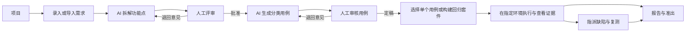

# AI 测试工作台改造

## 项目工作流

- 先选择工作区和项目，再进入需求、版本、环境、测试数据、用例、套件、执行、缺陷及报告。跨页交接保留项目上下文，工作区概览继续汇总当前租户。
- 测试申请、计划、准入、同行评审、日报、准出和报告是流程中的产物。它们保留项目与版本关联及人工签核记录，可从相应阶段进入。
- 需求文档先解析文字和表格，再由 AI 生成可验证的功能点。保留每轮功能点与原始需求修订的关系。退回时填写意见，AI 基于意见生成下一轮草稿，人工批准后用于用例生成。
- 功能测试、UI、API 和性能用例使用各自的结构。安全测试使用人工核验的防御性检查清单。AI 草稿可编辑、退回和再生成。正式执行以人工批准为门槛。功能和安全用例定稿后可在详情登记人工核验结果，并从执行记录查看。
- 版本记录基准与目标修订、需求影响和测试结果，环境记录测试地址与所属项目。Git 仓库分支、标签和差异的在线读取需要配置对应的仓库连接。
- 缺陷列表按项目和生命周期筛选。在详情中操作影响版本、复现步骤、预期与实际、处理人、解决版本、复测和关闭，并保留状态记录。

## 交互规则

- 采用手册第 36、48、51 条的克制管理台、全局项目上下文与主从详情，第 2、6、10、28 条用于按压、确认、加载和操作结果。每个页面只有一个主要操作。空状态提供进入下一步的入口。
- 按钮按压与聚焦有可见反馈。短暂过渡使用位移和透明度。详情与列表保留同屏关系，并适配窄窗口。启用系统减少动态效果时使用静态状态。
- 界面沿用 Auto-Test 的品牌和中文术语。写入、审批、执行以及模型调用均通过原有租户权限和审计边界。

## 参考依据

- 测试申请、计划、准入、同行评审、执行、问题跟踪和准出采用项目内「体系文档」与「测试输出文档」的流程和模板口径。
- 缺陷对照禅道的提出、确认、解决、测试验证、关闭与激活，以及影响和解决版本。 [提交 Bug](https://www.zentao.net/book/zentaopms/133.html) · [确认和解决](https://www.zentao.net/book/zentaopms/661.html) · [验证和关闭](https://www.zentao.net/book/zentaopms/898.html)
- 版本和环境对照 GitLab 的源、目标版本比较，以及部署环境与修订关联。 [比较修订](https://docs.gitlab.com/user/project/repository/compare_revisions/) · [环境与部署](https://docs.gitlab.com/ci/environments/)
- 套件参考 Azure Test Plans，将用例组织起来并与执行批次、环境及结果区分。 [测试计划与套件](https://learn.microsoft.com/en-us/azure/devops/test/create-a-test-plan?view=azure-devops)
